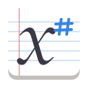
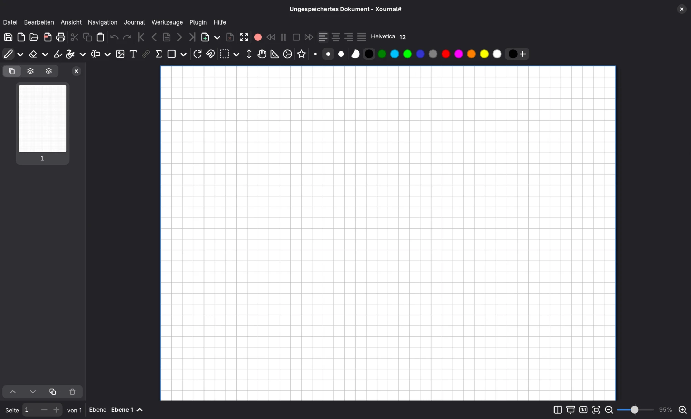

#   <br> Xournal#

**Xournal# is Xournal++ on GTK 4 with a modern GNOME look.** It is a personal fork of
[Xournal++](https://github.com/xournalpp/xournalpp), the hand note-taking and PDF annotation software.



> [!WARNING]
> **This is a vibe-coded experiment.** The GTK 4 / libadwaita work in this fork was largely by an AI
> coding assistant. I do this as a personal experiment on how far one can get with the current state of such tools.
>
> It is not reviewed by the Xournal++ developers, not affiliated with the Xournal++ project, and may contain bugs that
> the regular Xournal++ does not have. **I take no responsibility for unintended behaviour or lost data** — keep
> backups of important notes, and report problems here, not to Xournal++. That said, feel free to try it out, adapt
> or share to your liking.

## Why

Xournal++ is built on GTK 3, which is in maintenance mode, and looks somewhat dated on a current GNOME desktop. The goal
of this fork is a **modern user interface on the GTK 4 framework**:

- **GTK 4**, based on the Xournal++ GTK 4 port by Benjamin Hennion
  ([xournalpp/xournalpp#5615](https://github.com/xournalpp/xournalpp/pull/5615)), finished up to the point where no
  deprecated GTK API (up to GTK 4.14) is left, with the bugs found on the way fixed
- **libadwaita**: Adwaita style, the desktop's dark mode and accent colour, GNOME-style title bar and dialogs
- A UI that fits a GNOME desktop: symbolic icons, a sidebar styled like GNOME's document viewer, round colour swatches,
  a tidier zoom bar

The note-taking itself is unchanged: same features, same `.xopp` file format, same plugins.

## What is different from Xournal++

- GTK 4 and libadwaita instead of GTK 3
- "Symbolic (GNOME)" icon set (the default), follows light/dark mode and the system accent colour
- libadwaita window with header bar, GNOME-style message dialogs
- Sidebar with page cards, larger previews, and compact button blocks; page outline as a modern list
- Reworked colour palette, zoom bar and preferences spacing
- Its own name, icon, application ID (`io.github.cyrillvalentini.XournalSharp`) and settings folder
  (`~/.config/xournal-sharp`, so it **installs alongside the
  regular Xournal++** without interfering with it
- Lua plugins: the functions deprecated in Xournal++ 1.2/1.3 (`app.msgbox`, `app.uiAction`, …) are removed; use
  `app.openDialog`, `app.activateAction` etc. instead. All bundled plugins work.

## Installing

Currently **only Linux packages are provided: an RPM (Fedora) and a DEB (Debian / Ubuntu)**. There are no Windows,
macOS, Flatpak or AppImage builds of Xournal# yet.

Xournal# needs **GTK ≥ 4.14** and **libadwaita ≥ 1.6**, so a recent distribution:

| Distribution | Package | Notes |
|---|---|---|
| Fedora 41 or newer | `xournal-sharp-*.rpm` | built and tested on Fedora 45 |
| Debian 13 "trixie" or newer, Ubuntu 25.04 or newer | `xournal-sharp_*.deb` | built on Debian 13; Ubuntu 24.04 LTS is too old (libadwaita 1.5) |

Download the package from the [Releases](https://github.com/cyrillvalentini/xournalpp/releases) page and install it:

```bash
# Fedora
sudo dnf install ./xournal-sharp-*.rpm

# Debian / Ubuntu
sudo apt install ./xournal-sharp_*.deb
```

The program is installed to `/opt/xournal-sharp` and started as **Xournal#** from the application menu or with
`xournal-sharp` in a terminal.

## Building the packages

Both packages are built from the committed state of the repository:

```bash
# RPM (on Fedora; needs rpm-build and the build dependencies listed in the spec file)
packaging/xournal-sharp/make-rpm.sh          # -> ~/rpmbuild/RPMS/x86_64/

# DEB (on any Linux with podman; builds in a Debian 13 container)
packaging/xournal-sharp/make-deb.sh          # -> ~/debbuild/
```

For development builds, see the regular [compile instructions](readme/LinuxBuild.md); GTK 4, libadwaita and
GtkSourceView 5 development packages are needed instead of the GTK 3 ones.

## Branches

- `master`: Xournal# on GTK 4 (this README)
- `gtk4-port`: the Xournal++ GTK 4 port with the generic fixes from this fork, without the Xournal# look (candidates
  for upstream)
- `modern-ui`: the earlier Xournal# experiment on GTK 3

The port's progress and decisions are documented in [GTK4_PORT_PLAN.md](GTK4_PORT_PLAN.md).

## Features

These are the features of Xournal++, which Xournal# keeps:

- Supports pressure-sensitive styluses and digital pen tables (e.g. Wacom, Huion, XP Pen, etc. tablets)
- Paper backgrounds for note-taking, scratch paper, or whiteboarding
- Annotate on top of PDFs
- Select text from the background PDF, copy, highlight or underline it or strike it through
- Follow links from the background PDF
- Export to a variety of formats including SVG, PNG and PDF, both from the GUI and command line
- Different drawing tools (e.g. pen, highlighter) and stroke styles (e.g. solid, dotted)
- Shape drawing (line, arrow, circle, rectangle, spline)
- Use the set-square and compass tools for measurements or as a guide for drawing straight lines, circular arcs and radii
- Fill shape functionality
- Shape resizing and rotation
- Rotation and grid snapping for precise alignment of objects
- Input stabilization for smoother writing/drawing
- Text tool for adding text in different fonts, colors, and sizes
- Enhanced support for image insertion
- Eraser with multiple configurations
- LaTeX support (requires a working LaTeX installation) with customizable template and a resizable editor with syntax highlighting
- Sidebar containing page previews with advanced page sorting, PDF bookmarks and layers (can be individually hidden/edited)
- Allows mapping different tools/colors etc. to stylus/mouse buttons
- Customizable toolbar with multiple configurations, e.g. to optimize toolbar for portrait/landscape
- Custom color palette support using the .gpl format
- Page template definitions
- Bug reporting, auto-save, and auto backup tools
- Audio recording and playback alongside with handwritten notes
- Multi language support (over 20 languages supported)
- Plugins using Lua scripting

## Credits and license

Xournal# is based on [Xournal++](https://github.com/xournalpp/xournalpp) by the Xournal++ team and its contributors,
which in turn is partially based on [Xournal](http://sourceforge.net/projects/xournal/) by Denis Auroux. The GTK 4 port
it builds on is by Benjamin Hennion. All credit for the note-taking software goes to them; see the About dialog and
[AUTHORS](AUTHORS).

Like Xournal++, Xournal# is licensed under the [GNU GPL v2 or later](LICENSE).
